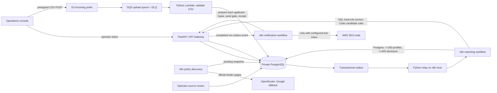

# ClickPe Loan Eligibility Engine

An explainable loan-product screening prototype for the ClickPe engineering-intern assignment. It turns a CSV of applicant profiles and a small catalogue of lender-published criteria into an auditable, source-linked review queue. It is a screening aid: a lender makes the actual lending decision.

## What is included

- **FastAPI and PostgreSQL** for bounded CSV ingestion, applicant records, source snapshots, decisions, event delivery, policy approvals and audit history.
- **React and TypeScript** workspace with separate Overview, Applicants and Policies pages, real upload progress, persisted processing tracking, grouped applicant results and numbered pagination.
- **Three n8n workflows** for daily official-page discovery, staged SQL/JavaScript applicant matching, and per-applicant personalized notification delivery. Matching uses versioned structured rules; there are zero model calls per applicant-product pair.
- **AWS infrastructure** for the API, S3 direct uploads, SQS and a DLQ, Lambda ingestion, private RDS PostgreSQL, retention, a private n8n host, and an HTTPS console served from the API Gateway origin. PostgreSQL and n8n have no public inbound port.
- **Docker Compose** for a local stack with the same n8n workflows and API.
- **GitHub Actions** for backend checks and a production TypeScript build.

## Architecture



### Decisions and safety boundaries

- The n8n matcher queries only `user_id`, income, score, employment status, age and approved rules. Names and email addresses never enter that workflow or an LLM request.
- A hard exclusion requires a confirmed mandatory cutoff. Preferred criteria can only pass or lead to review. Missing or location-specific rules produce `review`; extraction cannot activate policy on its own.
- Product rules cite official source pages. Operators see the extracted criteria and source excerpt before approving a new version. Each result stores the policy snapshot ID, fixed rule-engine version and criterion-level reasons.
- Uploads are size-limited to 25 MiB, the CSV schema and row values are checked, the raw cloud object is deleted after import, and abandoned S3 objects expire after one day. Applicant rows and per-person results are deleted after seven days.
- Workflow deliveries use a transactional outbox, deterministic page cursors and unique keys. A retried SQS delivery or n8n callback does not create duplicate results or pages.
- Execution input and output data are not saved in n8n. Error messages and operational audit records omit applicant values.
- Notifications default to **preview**, captured when each run is imported. Workflow C requires `NOTIFICATION_MODE=test`, verified `TEST_RECIPIENTS`, and `SES_SENDER`. Destinations come from this explicit allowlist, never from a CSV row. Enabling test mode does not send historical preview runs. On 17 October 2026, the user confirmed three synthetic applicant emails arrived across both controlled Gmail plus aliases. Use preview mode for bulk analysis.
- Every run pins its approved product snapshots at import. New approvals affect future runs only. Pages hold at most 200 applicants and 400 applicant-product decisions; the persistence endpoint checks the complete expected page before advancing the cursor.
- Each matched applicant has one delivery ledger entry per run and one email listing all matched products. Five applicants are claimed at a time, with an atomic send gate, two-second workflow pacing, a default three-email run cap and a conservative daily budget. Deferred work stays visible. The SES node does not retry sends; missing receipts become uncertain and are excluded from automatic recovery.

## Lender source baseline

The initial examples use official sources checked on 2026-10-14:

- [Axis Bank personal loan for salaried customers](https://www.axis.bank.in/loans/personal-loan/personal-loan-for-salaried): the curated example uses age 21-60, monthly income from INR 15,000, and treats a 700 score as preferred rather than a hard cutoff.
- [Bajaj Finserv personal loan](https://www.bajajfinserv.in/personal-loan): the curated example records a score threshold of 650 and a city-dependent salary criterion. Age and employment criteria remain unknown; successful known checks still go to review.

The linked source is the evidence. The prototype is not a full lender-policy catalogue, and the examples should be refreshed and independently confirmed before any external use.

## Data contract

The input CSV must contain exactly these headers, in any order:

`user_id,name,email,monthly_income,credit_score,employment_status,age`

Rows accept employment values `Salaried`, `Self-Employed`, or `Business`. `user_id` must be unique. Repeated email addresses are retained as separate applicant profiles; previews report both match count and distinct addresses. Bad rows fail the file with a safe error code, without returning row contents.

The assignment file has 10,000 rows, unique IDs, no missing fields, and repeated email addresses. It is intentionally excluded from Git. **Never turn on live mail using this dataset.**

## Local setup

Requirements: Python 3.12+, [`uv`](https://docs.astral.sh/uv/), Node 22+, Docker Desktop with Compose, and a browser.

```powershell
.\scripts\New-Environment.ps1
docker compose --profile local up -d --build
```

The script creates a private `.env` with random local secrets. Keep it out of source control. The compose stack runs Postgres, the API, n8n with an external task runner, an outbox relay and the web console.

Open [http://localhost:3000](http://localhost:3000) for the console. Retrieve the local operator token with:

```powershell
(Get-Content .env | Where-Object { $_.StartsWith('OPERATOR_TOKEN=') }) -replace '^OPERATOR_TOKEN=', ''
```

Open [http://localhost:5678](http://localhost:5678), create the n8n owner account, then configure credentials on the imported workflows:

1. **ClickPe internal token**: Header Auth, name `X-Internal-Token`, value from `INTERNAL_API_TOKEN` in `.env`. Assign it to both workflow Webhook triggers and their internal HTTP Request nodes.
2. **ClickPe Postgres**: host `db`, port `5432`, database/user `loan_engine`, password from `POSTGRES_PASSWORD`. Assign it to all Postgres nodes. TLS is disabled for local Compose only.
3. **OpenRouter**: Header Auth with name `Authorization` and value `Bearer <OpenRouter key>`.
4. **Google Gemini**: Header Auth with name `x-goog-api-key` and the separate Gemini API key.

Activate the three imported workflows. Workflow 1 checks lender sources daily. Workflows 2 and 3 are authenticated webhooks invoked from the transactional outbox. Source proposals remain pending until you approve them in the console.

Workflow 1 explicitly uses `Asia/Kolkata`; unchanged source excerpts skip model extraction. Workflow 3 also checks pending deliveries every minute, so expired pre-send claims can recover after an interrupted execution.

For local static analysis and tests:

```powershell
uv sync --extra dev
uv run ruff check app tests
uv run pytest
npm --prefix web ci
npm --prefix web run build
```

These checks do not need the supplied CSV or the LLM API keys.

## AWS demo deployment

The deployment script targets the `demo` stage in `ap-south-1`. It provisions a private PostgreSQL instance and Lambda networking, S3, SQS/DLQ, generated Secrets Manager values, API Gateway and an EC2 n8n host. The n8n host accepts no inbound connection; use Systems Manager to forward its local port. An authenticated AWS profile with the required CloudFormation, IAM, VPC, RDS, Lambda, API Gateway, S3, SQS, Secrets Manager and EC2 permissions is required.

```powershell
npm ci
.\scripts\Publish-Web.ps1 -AwsProfile nishantsingh02 -Stage demo
```

The script builds the console for the API's same-origin URL, packages it with the Linux Lambda application, applies database migrations, and uploads an application bundle with no CSV, screenshots, `.env`, or Git history. The ASGI server and relay HTTP client are installed only in the Docker image. To build a Lambda artifact in CI, run the **Build Lambda package** workflow; its archive includes the console assets.

Build and deploy the public operator console:

```powershell
.\scripts\Publish-Web.ps1 -AwsProfile nishantsingh02 -Stage demo
```

The command builds the React console into the Lambda package and serves the page and its static assets from the API Gateway HTTPS origin. The console URL is the API base URL printed by the command; opening it loads the workspace sign-in screen. The console and API share one origin, and S3 upload CORS is restricted to that API origin. The browser still requires the operator token; retrieve it from Secrets Manager using the ARN printed by the deployment script. Keep the token private.

Open n8n through a Systems Manager port-forwarding session:

```powershell
.\scripts\Open-N8n.ps1 -AwsProfile nishantsingh02
```

This resolves the current instance from CloudFormation and avoids PowerShell JSON quoting issues. Open `http://localhost:5678` and keep the tunnel terminal running. After a planned host replacement, complete the n8n owner setup again if prompted, then bind the OpenRouter and Gemini Header Auth credentials. Secrets Manager tokens and the RDS applicant data are preserved.

The deployment updates the existing EC2 services through Systems Manager, imports stable workflow IDs, binds the internal API and RDS credentials, and publishes matching and notification workflows. It downloads the AWS RDS CA bundle and verifies database certificates for n8n. Existing external credential bindings are retained. Discovery is published when both provider credentials are configured; otherwise it stays unpublished with the curated baseline available for matching.

Configure `OPENROUTER_API_KEY` and `GEMINI_API_KEY` privately in `/opt/clickpe/.env` (or bind the two provider Header Auth credentials in n8n), then rerun the host update. The owner account is still needed for accessing the n8n editor. The import updates the draft and publishing takes effect after n8n restarts.

Before each host update, the previous source is retained in `/opt/clickpe/previous-source.tar.gz` and the previous workflow export in the n8n volume. On failure, stop the relay, inspect the SSM command, restore compatible source and workflow versions, and restart services. Database migrations are additive; do not drop the new tables during rollback.

Deployment preserves the existing host's AMI and waits for cloud-init before taking a source backup or starting the rollout. Set `N8N_AMI_ID` explicitly only for a planned image replacement. The prototype's n8n editor account and credential metadata live on the host's local Docker volumes; an intentional replacement needs backup/restore or fresh owner setup. Applicant data and decisions remain in RDS.

The `demo` stack is billable while it exists. Retention limits applicant-data exposure; it does not stop AWS resource charges. Before deleting the stack, remove its private `deployment/source.zip` artifact from the upload bucket. Also empty the Serverless Framework deployment bucket if stack deletion reports it is non-empty. Do not delete the stack until you have saved anything needed for your submission.

## Main paths

- `app/api/routes.py`: operator API, policy-review gates, workflow handoffs and notification previews.
- `app/csv_ingestion.py`: bounded CSV validation, idempotent import and outbox event.
- `app/eligibility.py`: Python reference evaluator for correctness comparisons; production matching runs in n8n's Postgres and Code nodes.
- `app/matching.py`: bounded SQL contract shared with the exported n8n Postgres node.
- `app/api/workspace.py`: grouped applicant results, progress and history endpoints.
- `migrations/`: product snapshots, applicant data, results, outbox, notification events and audit records.
- `n8n/workflows/`: the three credential-free workflow exports.
- `serverless.yml`: AWS stack, private networking and function-level permissions.
- `web/src/`: responsive operator console.

## Controlled SES demonstration

A received email sent to test-inbox aliases is required by the assignment. On 17 October 2026, the user confirmed all three personalized emails from the synthetic alias run arrived, and that both controlled `+one` and `+two` aliases were shown. Inbox placement is not claimed.

1. The sender and both aliases have been verified individually in SES `ap-south-1`. Gmail plus aliases reach the existing inbox; no additional Gmail accounts are needed. Sandbox recipients must be verified unless covered by a verified domain. [SES sandbox rules](https://docs.aws.amazon.com/ses/latest/dg/request-production-access.html), [Gmail aliases](https://support.google.com/mail/answer/22370?hl=en).
2. Keep the private deployment environment in `NOTIFICATION_MODE=preview` for normal use. For a controlled demonstration only, set `NOTIFICATION_MODE=test`, the two already verified aliases in `TEST_RECIPIENTS`, and the verified sender in `SES_SENDER`. Deployment procedures are maintained separately and must synchronize Lambda import mode, IAM restrictions, and host configuration.
3. Deployment binds `clickpe-ses` as an AWS Assume Role credential. EC2 IMDSv2 supplies renewable source credentials; the dedicated role permits only `ses:SendEmail` from the configured identity to configured destinations. The external ID is read from Secrets Manager. No IAM user keys are needed. [n8n system credentials](https://docs.n8n.io/integrations/builtin/credentials/aws/).
4. A headed browser uploaded three invented eligible applicants in run `a21cde4c-0831-4436-b1e9-db21ae668e93`. The ledger recorded three sends and all three emails were confirmed received across both controlled aliases. Each matched applicant gets one personalized email with all matched products; a profile with no matches gets no email. Show one received message in the recording with the base address masked.
5. Restore preview mode and redeploy before using the supplied 10,000-row file. Test mode defaults to three messages per run and a 180-message rolling daily budget, below the sandbox's 200-message quota; account usage outside this application still counts against AWS limits.

The stock n8n SES node discards detailed AWS error codes on its error output. Recognizable HTTP 429 errors receive bounded retry; generic HTTP 400/403 rejections require explicit recovery after correcting the cause. Transport ambiguity stays `uncertain`. The internal `POST /internal/v1/resume-notifications/{run_id}` operation requeues only deferred or definitively failed test deliveries; it never requeues sent, sending, uncertain or preview entries. Check SES before resolving an uncertain outcome. Legacy `test_delivery` receipts are retained for audit.

## Discovery model

The primary extraction model is `nvidia/nemotron-3-super-120b-a12b:free` on OpenRouter, selected by the user after the paid model returned an insufficient-credit error. Its [provider metadata](https://openrouter.ai/api/v1/models/nvidia/nemotron-3-super-120b-a12b:free/endpoints) advertises structured-output support. Requests retain the strict JSON schema, require provider parameter support, use a 4,000-token budget and low reasoning effort, and save the actual requested model with each proposal. Advertised rates must be selected from exact source-derived strings and paired with a verbatim source excerpt; the server rejects paraphrases and normalized rates. The latest live proposal captured a source-quoted Bajaj rate but left eligibility rules unknown, so it remains pending and the curated active policy stays unchanged. A deterministic source guard now preserves clear required or preferred CIBIL score minimums and leaves negated, strict or upper-bound comparisons unknown with their quote and limitation. Because the source excerpt has not changed, the pending live proposal has not been re-extracted with this guard. Gemini remains the bounded fallback. Both providers have two attempts, a 60-second request timeout and a 2.5-second retry delay. Free endpoint availability and quotas can change; unsuccessful extraction leaves the approved catalogue intact.

## Workspace behavior

The Overview page shows **Upload / Import / Match / Ready**. Transfer percentage comes from browser byte events; 100% transfer waits for storage confirmation. Import is indeterminate. Matching percentage comes from persisted decisions against pinned products. Confirmed jobs continue across route changes and resume after refresh; unfinished file transfers require selecting the file again.

Applicants are grouped once per profile: any eligible product means **Matched**; otherwise any review decision means **Needs review**; all failed decisions mean **No matches**. Incomplete profiles remain **Processing**. The 25/50/100 pagination controls, filters and selected run are reflected in the URL. Drawer details retain every product's outcome and source evidence. Summary counts describe applicants; per-product decisions remain available through the original results API.

## Staged matching and schema mapping

The assignment's product catalogue is represented by `product` plus immutable `policy_snapshot` rows; `run_policy` pins the snapshots used by an import. Successful matches are `eligibility_result` rows with `decision='eligible'`. This normalized design preserves source versions and stores rejected/review decisions alongside matches for audit.

The n8n Postgres node screens confirmed mandatory employment, age, location-independent income and credit-score rules. Rejected pairs receive complete ordered findings directly from SQL; only survivors enter the JavaScript evaluator for advisory and unknown criteria. All pairs are persisted, and a page still contains at most 400 decisions. Server-computed candidate/rejection counters are updated only once per accepted cursor.

This reduces candidate work in the JavaScript stage, not the asymptotic applicant-product comparisons performed by SQL. Report measured throughput and candidate reduction, not an invented complexity improvement. The parity fixture compares every decision and ordered finding against the frozen previous n8n implementation, including fractional thresholds, preferred criteria and unknown/location-dependent terms. `rules-v2-staged` identifies the new execution strategy.

The isolated 10,000-applicant / 50-product benchmark compared 500,000 decisions with complete explanation parity and eliminated 75.96% of candidates before JavaScript. This component benchmark excludes persistence and n8n orchestration.

## Validation and submission

CI runs the actual n8n matcher JavaScript against disposable PostgreSQL fixtures. Coverage includes import SQL, three-product pagination, policy changes during a run, duplicate callbacks, incomplete-page rejection, notification handoff, policy audit inserts, and terminal relay failures. Set `TEST_DATABASE_URL` to a disposable PostgreSQL database to run the integration cases locally; the fixture creates and drops an isolated schema.

The live 10,000-row run completed with a 42.14-second matching time; this excludes upload and import. The isolated benchmark is separately labeled and excludes persistence and orchestration.

The alias email requirement is complete. The local narration script remains ignored and uncommitted. Owner setup is complete; recording and the submission form remain. Reviewer invitations were deferred and have not been sent. Submit the repository and recording links through the assignment [submission form](https://docs.google.com/forms/d/e/1FAIpQLSe1ET4U8rOcPM3VGJ8fT5HhigTO9fKuDlsB_wHtB5acWys9XQ/viewform) after the video is ready.

Infrastructure tooling still uses Serverless Framework 3 for deployment compatibility. As of 17 October 2026, GitHub Dependabot reports 12 open alerts on `package-lock.json` development dependencies (3 critical, 3 high, 5 medium, 1 low); these packages are not included in the Python Lambda or browser runtime. Pinned overrides patch `tar`, `adm-zip`, and the Git argument parser while retaining the simple-git 3 API required by Serverless 3. A simple-git 4 override broke the legacy dashboard plugin. Review the [current Dependabot alerts](https://github.com/nishantsingh02/clickpe/security/dependabot); upgrading the deployment toolchain requires separate package and deployment validation.
